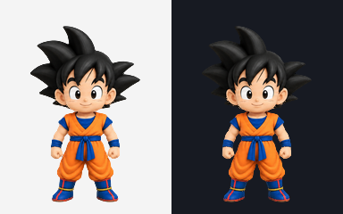
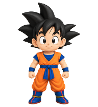

# גוקו · Goku 🟠

A tiny, cheerful Goku from Dragon Ball Z to keep you company in Codex.

**[Download the pet package](https://github.com/YossiBenagou/goku-codex-pet/releases/latest/download/goku.zip)**

## התקנה

1. הורידו את [חבילת גוקו](dist/goku.zip) וחלצו אותה.
2. העתיקו את התיקייה `goku` לתיקיית חיות המחמד של Codex:
   - Windows: `%USERPROFILE%\.codex\pets\`
   - macOS / Linux: `~/.codex/pets/`
   - אם הגדרתם `CODEX_HOME` אחר, השתמשו בתיקיית `pets` שבתוכו.
3. בתוך `goku` צריכים להיות הקבצים `pet.json` ו־`spritesheet.webp`.

לעדכון התקנה קיימת, החליפו את שני הקבצים בגרסה החדשה.

## Install

Download and extract the ZIP. Copy the `goku` folder to `$CODEX_HOME/pets/` (default: `~/.codex/pets/`). The folder must contain both `pet.json` and `spritesheet.webp`. Replace both files when updating.

## Animations

| Animation | What Goku does |
| --- | --- |
| Idle | Rests and blinks |
| Move right / left | Runs in either direction |
| Wave | Gives a friendly greeting |
| Jump | Crouches, jumps and lands |
| Failed | Looks disappointed and recovers |
| Waiting | Asks expectantly for your input |
| Working | Thinks and has an idea |
| Review | Looks carefully and nods |

Also includes **16 gaze directions**.

## Package details

- Codex pet format: `spriteVersionNumber: 2`
- Atlas: 1536 × 2288 pixels; 8 columns × 11 rows
- Cell size: 192 × 208 pixels
- 9 animation rows, 16 gaze poses and a neutral frame
- Clean alpha edges and lossless transparent WebP
- Structural validation and independent visual and direction checks passed

The pet is an animated visual companion; conversations take place in Codex chat.

## Credits

Created with OpenAI image generation, assembled for Codex, and refined with local alpha-edge cleanup. Unofficial fan artwork inspired by Goku from Dragon Ball Z; not affiliated with the franchise or its rights holders.
